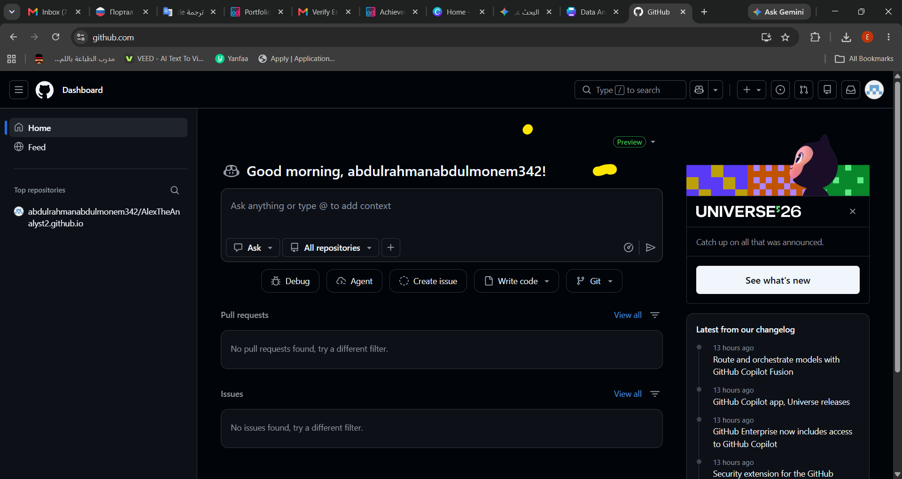

# 🥉 3rd Place - University Data Visualization Competition

## 📌 Project Overview
This repository contains the interactive sales dashboard developed for the **University Data Analysis & Visualization Competition**, where the project was awarded **3rd Place**.

---

## 📊 Dashboard Preview

---

## 🏆 Official Achievement Proof

---

## 📂 Repository Contents & Tools
* **Power BI File:** `Project (Result).pbix`
* **Raw Dataset:** `Csv.csv`
* **Core Skills:** Data Cleaning, Data Modeling, Dashboard UI/UX Design

---

## 👤 Author
* **Abdulrahman** — Computer Science Student
